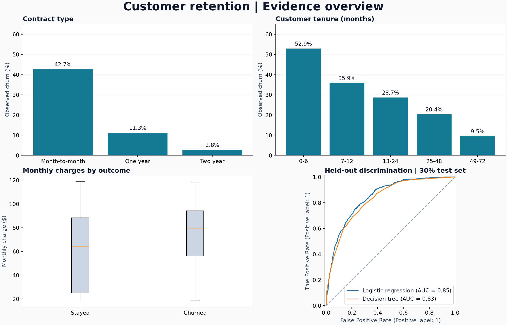

# Customer Retention Analytics

A reproducible business intelligence project that turns a telecommunications customer sample into clear retention segments and an honest comparison of predictive models.



**Explore:** download the repository and open [`reports/index.html`](reports/index.html) for the offline analytical report. No login, server or Power BI subscription is required. GitHub displays the HTML source rather than serving the page.

## Business question

Which customer segments show elevated churn, and how well can simple models identify churn on a held-out portion of the sample?

The analysis separates two tasks:
- **Descriptive analysis:** compare observed churn by tenure and contract type, and monthly charges by churn status.
- **Predictive evaluation:** compare a majority-class baseline, logistic regression and a constrained decision tree on the same test rows.

Neither task estimates the causal effect of changing contracts or prices. Recommendations are experiments to test, not promised financial outcomes.

## What is built

- Validated input schema, numeric parsing and unique-record checks.
- Reproducible stratified 70/30 split with seed 42.
- Train-only median imputation, scaling and one-hot encoding inside scikit-learn pipelines.
- Fixed model settings, six evaluation metrics and confusion matrices.
- Aggregate CSV outputs, a JSON evidence record, publication-quality charts and an offline HTML report.
- Regression tests for invalid inputs, leakage-sensitive preprocessing and unseen categories.

## Reproduce

Tested with Python 3.14 on Windows; exact package versions are in `requirements.txt`.

```powershell
python -m venv .venv
.venv\Scripts\python -m pip install -r requirements.txt
.venv\Scripts\python fetch_data.py
.venv\Scripts\python analysis.py
.venv\Scripts\python -m pytest -q
```

On macOS/Linux use `.venv/bin/python` instead. `fetch_data.py` downloads the pinned public IBM sample and checks its SHA-256 before saving it. Analysis is then local and offline. Input data are deliberately not committed.

## Results at a glance

On the fixed 2,113-row test set, logistic regression reached **0.845 ROC AUC**, compared with **0.830** for the tree and **0.500** for the majority baseline. Logistic recall was **55.8%**; the tree traded more false positives for **60.2%** recall. See [findings and interpretation](FINDINGS.md) for the full comparison, not accuracy alone.

## Method and decision boundaries

`customerID`, the target and demographic/household variables are excluded from the feature matrix. Excluding demographics does **not** establish fairness: remaining variables may be proxies, and this project does not include a fairness audit.

Missing `TotalCharges` values are imputed with the training median. No imputation or scaling is fitted on test data. Logistic regression uses a 0.5 decision threshold. The tree uses depth 5 and at least 30 records per leaf. These choices are fixed in code rather than selected on test results. The baseline shows why accuracy alone is insufficient.

The test split supports only a within-sample evaluation. It is not temporal validation, calibrated production risk, proof of generalization to another company, or evidence of campaign impact. An operational system would require consent/access controls, stability monitoring, temporal evaluation and intervention testing.

## Project provenance

This implementation was reconstructed in November 2026 around the customer-churn question from CIS 3252W coursework. It is **new, executable portfolio work**, not the original submitted code or an exact reproduction of the original reported metrics. Its figures and metrics are computed by the committed pipeline. Original course submissions, instructor feedback and personal information are not published.

The existing repository is retained rather than creating a duplicate project. This is Python-based analytics, not a Power BI/Tableau dashboard or production deployment.

## Data and attribution

IBM's public Telco Customer Churn sample, pinned to [source commit d5371f5](https://github.com/IBM/telco-customer-churn-on-icp4d/tree/d5371f5d83a446ad5673cbcca3b814b926491f8a). The source repository carries [Apache-2.0](licenses/IBM-Apache-2.0.txt). See [`DATA_SOURCE.md`](DATA_SOURCE.md) for provenance, checksum and reuse notes. Only aggregate outputs are published here; no coursework attachments, account identifiers or customer-level prediction files are included.

